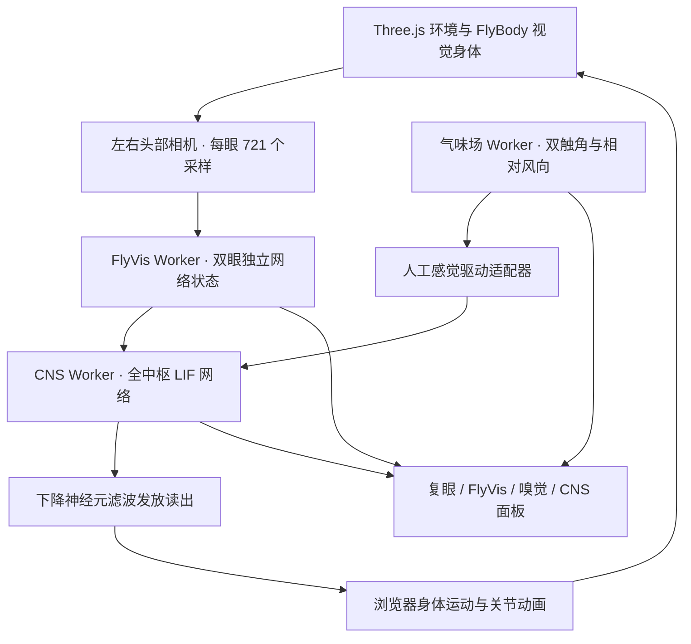

# 架构与模型边界

FlyNeuro 是一个纯静态 React + TypeScript 应用。Vite 负责开发与构建，Three.js 负责三维渲染，Web Worker 负责视觉网络、全 CNS LIF 网络和气味场计算。运行时不依赖数据库、API 密钥或服务端计算。

## 数据流

## 模块职责

| 模块                                  | 职责                                              |
| ------------------------------------- | ------------------------------------------------- |
| `src/App.tsx`                         | 应用状态、交互控件、Worker 指标与视图编排         |
| `src/simulation/WorldCanvas.tsx`      | 场景生命周期、传感器、Worker 通信、碰撞与身体更新 |
| `src/simulation/environment.ts`       | 可复现的程序化环境构造和植物几何                  |
| `src/simulation/constants.ts`         | 复眼采样坐标、花朵位置、阶段标签和身体参数        |
| `src/simulation/types.ts`             | 场景、感觉数据与神经活动的类型契约                |
| `src/components/WholeBrainCanvas.tsx` | 神经元位置解码与三维 CNS 活动显示                 |
| `src/components/ActivityPanels.tsx`   | 眼部画面、复眼六边形图、时间曲线与指标            |
| `src/components/ui/`                  | 实际使用的按钮、滑块与标签页组件                  |
| `src/lib/fly-brain-codec.ts`          | 上游 FLYN 神经元坐标解码                          |
| `public/workers/`                     | 独立加载的神经网络与气味场计算模块                |

Worker 文件作为静态资源保留在 `public/`，其相对导入和模型数据路径保持一致。神经数据和身体模型作为二进制文件管理，`.gitattributes` 阻止文本换行转换。

## 模型边界

- **视觉网络**：两台头部相机生成左右图像，每眼采样 721 个复眼柱，推进独立的 FlyVis 模型状态。每眼模型包含 45,669 个节点。
- **全 CNS**：使用 165,122 个神经元和 10,511,038 条连接的 LIF 网络。FlyVis 活动通过上游映射进入 CNS，身体运动读取下降神经元的滤波发放。
- **寻香**：气味场、双触角采样与感觉到导航驱动的适配器是项目中的近似实现，包含人工规则；尚未接入经过验证的完整嗅觉感觉运动回路。
- **身体**：FlyBody 提供视觉网格，位移、碰撞和关节动画由浏览器代码实现。尚未接入完整 MuJoCo 动力学、肌肉模型或关节力矩控制。
- **气味与时间**：气味羽流是浏览器规模的近似模型，不是 CFD 求解。神经模型时间可能慢于渲染场景时间。

这些边界使项目适合交互探索、机制演示与工程原型；当前结果不能作为经过验证的果蝇行为预测。

## 验证范围

`pnpm check` 执行格式检查、类型检查、气味场回归检查和生产构建。气味场检查覆盖近源信号连续性、顺风梯度和局部感觉读数，不代表完整神经行为验证。

涉及渲染或交互的变更，还应在支持 WebGL 的浏览器中检查场景、模型加载、CNS 初始化、暂停、继续、重置和各面板切换。

## 项目沿革

项目最初以 FlyVis Observatory 发布，对应 Sites 第 26 版（`2e60842cb71eea3bf949ba511f310baeea892351`），随后命名为 FlyNeuro 并接入个人主页。

当前仓库聚焦于 GitHub Pages 静态版本。旧版 Sites、Cloudflare 和数据库模板已从主线移除，可通过 Git 历史查看；本地工作区还保留了 `archive/sites-original/` 原始工程。
